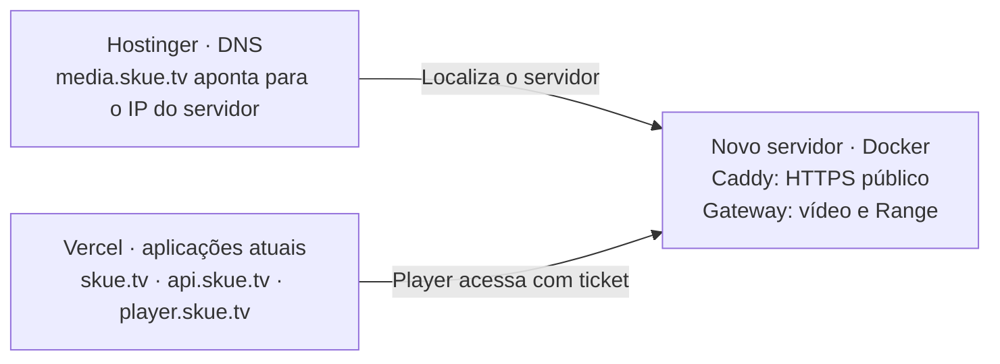
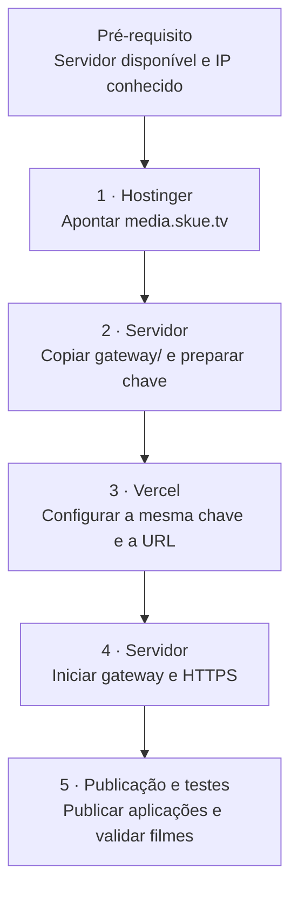
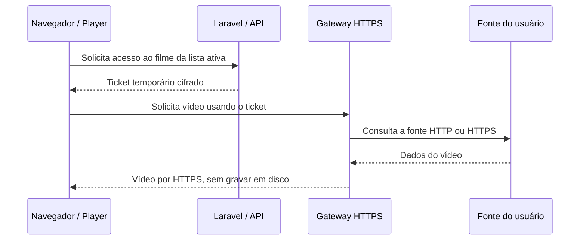

# Gateway opcional de filmes

Implementação preparada localmente. **Não publicada ou ativada em produção.** Requer servidor público com Docker Compose, IPv4 e tráfego de saída compatível com vídeo; o domínio comprado não fornece essa hospedagem.

## Fluxo

O player tenta o filme HTTPS diretamente. Se o acesso falhar, pode pedir um ticket ao Laravel. Para HTTP em uma página HTTPS, pede o ticket antes de tentar a requisição que seria bloqueada. O Laravel verifica token de dispositivo e propriedade da lista Xtream ativa, constrói a URL de filme e cifra a autorização. O navegador transmite pelo gateway HTTPS. O gateway consulta a origem HTTP/HTTPS e acompanha redirecionamentos públicos, sem gravar ou cachear vídeo. A transmissão **passa pelo servidor**: esta é uma mudança em relação à arquitetura de reprodução somente direta; ativá-la exige atualizar a descrição operacional e revisar os documentos comerciais/jurídicos existentes antes de lançamento.

APKs com a ponte NativePlayer continuam diretos. Navegadores Android sem essa ponte usam HTML5. Nesta etapa somente filmes Xtream MP4/M4V/WebM; não inclui M3U arbitrário, episódios, Live, HLS/segmentos, conversão de codecs ou DRM. Não se deve anunciar todos esses casos como resolvidos.

## Instalação — guia visual

**Situação atual:** código e testes locais preparados; gateway público ainda não instalado. Os passos abaixo descrevem o que será feito, não uma instalação já concluída.

### Onde cada parte fica



**DNS** é o endereço que localiza o servidor. **VPS** é o computador remoto que executará o gateway. **Caddy** cuida do certificado HTTPS. **Ticket** é uma autorização temporária para acessar um filme.

### Antes de começar — ter um servidor

O domínio na Hostinger não inclui o computador que executará o gateway. Primeiro é necessário definir uma hospedagem com acesso de administração, Docker Compose, IPv4 público e tráfego de saída adequado para vídeo. Não é necessário migrar o portal, a API ou o player.



### 1. Hostinger — apontar o endereço

**Onde:** zona DNS de `skue.tv` no hPanel.

Crie um registro com estes campos:

```text
Tipo:   A
Nome:   media
Valor:  IPv4 público do servidor escolhido
```

Preserve os registros atuais do portal, API e player. Não crie um registro AAAA sem IPv6 funcional no servidor.

**Pronto quando:** `media.skue.tv` resolver publicamente para o IP correto. DNS correto, sozinho, ainda não significa que o gateway esteja funcionando.

### 2. Servidor — preparar arquivos e chave

**Onde:** terminal do novo servidor, dentro da pasta `gateway/` copiada deste projeto.

Copie o diretório `gateway/` completo. Gere uma chave exclusiva de **32 bytes aleatórios em base64**, salvando-a diretamente em arquivo privado ou gerenciador de segredos. Crie `.env` com esta estrutura ilustrativa:

```dotenv
MEDIA_PUBLIC_HOSTNAME=media.skue.tv
MEDIA_GATEWAY_KEY=CHAVE_EXCLUSIVA_GERADA_NO_SERVIDOR
```

O texto `CHAVE_EXCLUSIVA_GERADA_NO_SERVIDOR` é um marcador: precisa ser substituído pelo segredo real, sem enviá-lo ao chat ou ao Git. Proteja o arquivo:

```sh
chmod 600 .env
```

Não reutilize `APP_KEY` nem coloque a chave no frontend. Preserve a mesma chave nos reinícios. Libere TCP **80 e 443** no servidor; a porta **8080 permanece interna à rede Docker**.

**Pronto quando:** arquivos copiados, `.env` privado configurado e portas públicas corretas.

### 3. Vercel — preparar a ligação com o Laravel

**Onde:** variáveis privadas do projeto **backend** na Vercel, no ambiente em que o Laravel será publicado.

Configure:

```dotenv
MEDIA_GATEWAY_URL=https://media.skue.tv
MEDIA_GATEWAY_KEY=A_MESMA_CHAVE_PRIVADA_DO_SERVIDOR
```

As duas configurações compartilham a mesma chave: o Laravel cria o ticket e o gateway valida esse ticket. O navegador recebe o ticket, não a chave. Não crie variáveis `VITE_*` para esse segredo.

**Pronto quando:** a URL e a chave estiverem cadastradas no backend. A aplicação publicada utilizará os valores após o novo deploy; faça a publicação na etapa 5, depois de validar o gateway na etapa 4.

### 4. Servidor — iniciar o gateway e o HTTPS

**Onde:** terminal do servidor, na pasta `gateway/` que contém `.env` e `compose.yaml`.

```sh
docker compose config --quiet
docker compose up -d --build
```

O primeiro comando valida a configuração sem imprimir os segredos. O segundo constrói e inicia o gateway e o Caddy. Com DNS e portas corretos, o Caddy obtém o certificado HTTPS; preserve seus volumes de certificados.

```text
Internet → HTTPS:443 → Caddy → gateway:8080
                         └── certificado HTTPS
```

Não execute `docker compose config` sem `--quiet`, pois ele revela as variáveis interpoladas.

**Pronto quando:** `https://media.skue.tv/health` responder com `{"status":"ok"}` e certificado válido. Não ignore erros de certificado para considerar a etapa concluída.

### 5. Publicação — testar antes de liberar

**Onde:** deploy dos projetos backend e player na Vercel; depois, navegador em `player.skue.tv`.

Publique o backend com as variáveis da etapa 3 e o player com este código. Sem a configuração completa, a emissão de tickets fica desativada e responde `503 MEDIA_GATEWAY_UNAVAILABLE`.

Valide os seguintes caminhos com uma fonte autorizada:

- Filme HTTPS que já funciona continua tocando diretamente.
- Filme HTTP utiliza o gateway HTTPS e reproduz no navegador.
- Avançar no filme, pausar, retomar e fechar funcionam; fechar cancela a transmissão na origem.
- Certificado e CORS permitem o acesso de `player.skue.tv` ao gateway.
- A fonte aceita o IP da hospedagem, o formato reproduz nos navegadores previstos e a capacidade comporta a concorrência planejada.

**Pronto quando:** esses resultados estiverem confirmados no ambiente público. Testes locais não comprovam aceitação do IP pela fonte. Só depois avance para séries/Live e atualização do APK; esta implementação cobre somente filmes Xtream MP4/M4V/WebM.

### O caminho do vídeo depois da instalação



Esse desenho representa o caminho via gateway; filmes HTTPS funcionais e APKs com NativePlayer mantêm o acesso direto. O gateway retransmite o vídeo, alterando a premissa de reprodução somente direta descrita no início deste documento.

**Privacidade durante a instalação:** nunca habilite logs de URL, query, corpo, cabeçalhos ou tickets em proxies, APM e analytics. O Caddyfile descarta access logs e remove URI/cabeçalhos dos logs estruturados de execução; revise também os logs da hospedagem. Não envie tickets para ferramentas externas. O gateway não encaminha cookies, Authorization, Origin ou Referer do navegador à fonte.

## Limites e operação

- AES-256-GCM com chave exclusiva; ticket é uma credencial de acesso temporário, expira em até6h. Copiar o ticket permite reutilizá-lo até expirar. Desativar/remover dispositivo impede novos tickets; tickets existentes **não são revogados imediatamente**. Rotação da chave invalida todos. Não foi implementada consulta ao banco a cada Range.
- DNS IPv4 público validado e fixado em cada salto; destinos privados/reservados, IPv6, credenciais de URL e esquemas não HTTP(S) são rejeitados. Validação TLS permanece ativa. Até5 destinos na cadeia de redirecionamentos; cabeçalhos10s e inatividade15s.
- Range único, GET/HEAD, 200/206 e backpressure; fechamento cancela a origem. Corpo nunca é acumulado inteiro. Limite padrão32 requisições simultâneas/processo e3/ticket, retornando429 em excesso; não é uma promessa de32 espectadores. Capacidade precisa de ensaio no servidor escolhido.
- Recusas401/403/451 são preservadas, sem tentar outra fonte. Falha de rede502, DNS lento504, tipo não suportado415. Ticket inválido/expirado403. Não se mascara recusa como erro de codec.
- Não altera HTTP para HTTPS artificialmente, desabilita certificados, falsifica identidade de outros aplicativos ou contorna restrições. A origem continua podendo recusar IP de datacenter, restringir conexões ou entregar codec não suportado.
- A saída de vídeo consome banda do servidor proporcional a bitrate × espectadores × tempo. Dimensione rede/franquia, CPU e conexões; acompanhe CPU, memória, tráfego, quantidade/latência/status de requisições sem dados privados. Reinícios ou atualizações podem interromper sessões; o encerramento concede até30s antes de sair. Planeje manutenção.
- `npm test` exige Node>=22 e PHP CLI com OpenSSL para o teste cruzado. Os testes de rede usam apenas servidores sintéticos em loopback e adaptação de transporte exclusiva dos testes; o processo de produção não permite destinos locais.

## Reversão

Remova as duas variáveis `MEDIA_GATEWAY_*` do Laravel e publique novamente; novas solicitações deixam de receber tickets. Desligar o gateway interrompe sessões que o utilizam. Filmes HTTPS diretos e APK nativo seguem o fluxo original. Não apague listas, histórico ou favoritos.
